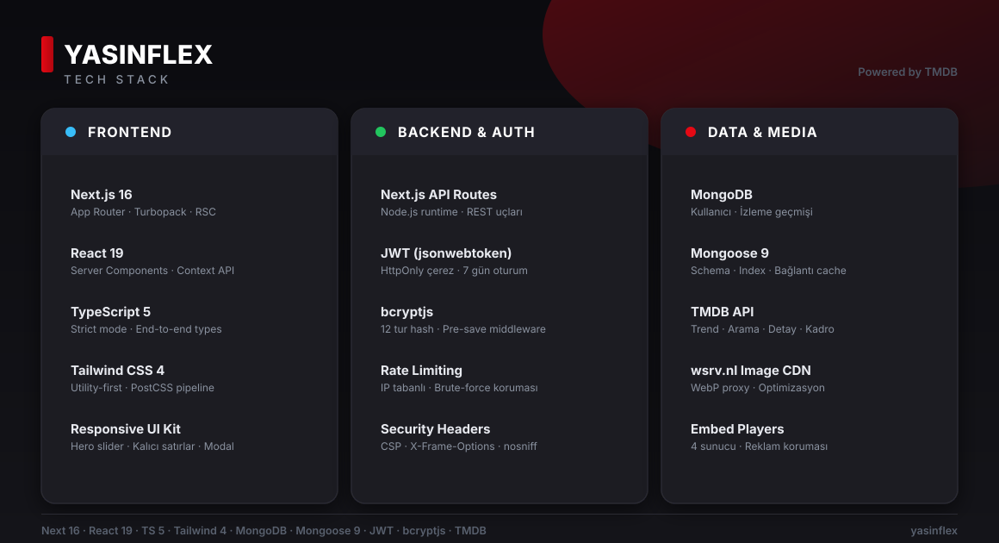

<div align="center">

# 🎬 Yasinflex

**A Netflix-style streaming platform — browse, discover and watch movies & TV shows, built with Next.js 16 and TMDB.**


</div>

---

## ✨ Features

- **Home dashboard** — trending of the week, popular movies & TV, now playing, top rated, upcoming and airing today, all on one page with a cinematic hero slider
- **Movies & TV catalogs** — filter by genre, clean grid layouts, detail pages with cast, trailers, recommendations and similar titles
- **Search** — instant multi-search across movies and TV shows
- **Watch & continue** — multi-server embedded player with ad protection, auto "next episode" countdown, and a *Continue Watching* row that tracks your exact season/episode/progress
- **Accounts & guests** — register/login with JWT (HttpOnly cookie), plus guest mode: your history works before you ever sign up, then stays with your account
- **Personal watchlist** — save titles for later
- **Image CDN** — TMDB posters/backdrops proxied through wsrv.nl as optimized WebP

## 🎨 Tech Stack



| Layer | Technology |
|---|---|
| Framework | [Next.js 16](https://nextjs.org) (App Router, Turbopack, RSC) |
| UI | React 19 · Tailwind CSS 4 · TypeScript 5 |
| Backend | Next.js API Routes (Node.js runtime) |
| Database | MongoDB + Mongoose 9 |
| Auth | JWT (HttpOnly cookie) + bcryptjs (12-round hashing) |
| Metadata | [TMDB API](https://developer.themoviedb.org) |
| Media | wsrv.nl image CDN · embedded multi-source players |

## 🚀 Getting Started

```bash
# 1. Install dependencies
npm install

# 2. Configure environment
cp .env.example .env.local
#    → set MONGODB_URI, JWT_SECRET and NEXT_PUBLIC_TMDB_API_KEY

# 3. Run
npm run dev        # development → http://localhost:3000
npm run build && npm start   # production → http://localhost:4000
```

### Environment Variables

| Variable | Description |
|---|---|
| `MONGODB_URI` | MongoDB connection string (required) |
| `JWT_SECRET` | Secret used to sign auth tokens — **required in production** (`openssl rand -hex 32`) |
| `NEXT_PUBLIC_TMDB_API_KEY` | Your [TMDB API key](https://www.themoviedb.org/settings/api) |

## 🔒 Security

The app ships with hardened defaults:

- **Hardened security headers** — CSP, `X-Frame-Options`, `X-Content-Type-Options`, `Referrer-Policy` and a strict `Permissions-Policy` via `next.config.ts`
- **Hardened auth** — bcrypt-hashed passwords, JWT in `HttpOnly` / `SameSite=Lax` / `Secure` cookies, generic login error messages (no user enumeration)
- **Brute-force protection** — IP-based rate limiting on login & register endpoints
- **Input validation** — every API route strictly validates and coerces request data (no shell/NoSQL injection, size/bounds limits on user content)
- **Ownership checks** — watch-history records can only be read/deleted by their owner

## 📁 Project Structure

```
├── app/                  # Next.js App Router — pages & API routes
│   ├── api/auth/         # register · login · session (me)
│   ├── api/watch-history/
│   ├── movie/[id]/       # movie details
│   ├── tv/[id]/          # TV show details
│   └── ...               # home · movies · tv · search · watchlist
├── components/           # Navbar, HeroSlider, MovieCard, VideoPlayer, ...
├── contexts/             # AuthContext (session + guest identity)
├── lib/                  # tmdb client · mongodb · auth · rate-limit
├── models/               # Mongoose schemas (User, WatchHistory)
└── public/               # static assets (incl. tech-stack.svg)
```

## ⚠️ Disclaimer

This project uses [TMDB](https://www.themoviedb.org) for metadata but **is not endorsed or certified by TMDB**. Content is streamed via third-party embed providers — it is a demo/portfolio project and should not be used to host or distribute copyrighted media. Use responsibly.
